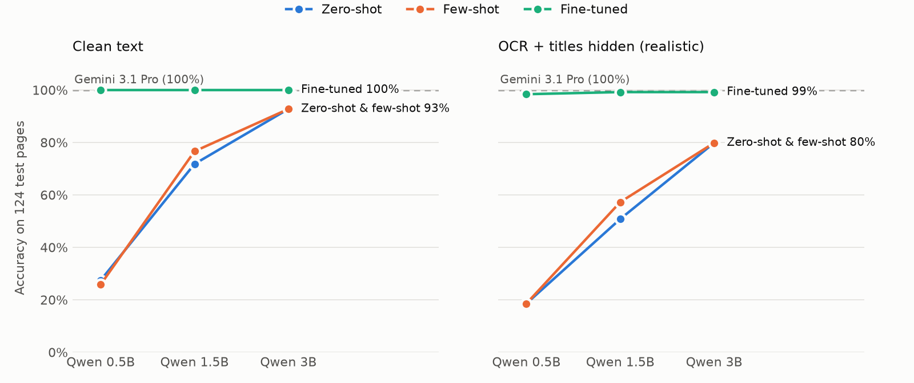

# Casefile

Open models and a benchmark for Indian health-insurance claims.

Built by Sudhakar Reddy, founder of [Policygaido](https://policygaido.com). Casefile powers
FairClaims, which helps people challenge rejected and underpaid health-insurance claims.

## The question

**Can a 0.5B model running on a laptop match a frontier model on a narrow claims task,
after minutes of training?** Claim files are sensitive health data, so a small model that
runs privately and costs almost nothing per page is a real product argument.

Casefile answers it one task at a time, each with a frozen test set, a ladder of baselines
and a success bar written down before any results. The reasoning behind every decision is
in the **[research log](docs/LOG.md)**.

## Results so far

**F5: reading claim documents precisely (latest).** Fine-tuned Qwen 1.5B/3B extract every field
right on 98% of clean pages, matching Gemini (99%), but only 86–88% on OCR'd pages against
Gemini's 97%, a real gap. A first GRPO run on top didn't close it, and the write-up explains
why. **[Full results →](results/f5.md)**

**F2: sorting claim documents.** A fine-tuned 0.5B model matches Gemini: 100% on clean text and
98.4% on OCR'd pages with headings hidden, against 79.8% for the best *prompted* 3B model.
8 minutes of training on one GPU. **[Full results →](results/f2.md)**

<picture>
  <source media="(prefers-color-scheme: dark)" srcset="results/f2_chart_dark.png">
  
</picture>

## Status

| Stage | What | State |
|---|---|---|
| Synthetic data | 800 claim pages (10 document types × 80) generated from 314 sampled claim cases, each with a clean render and a phone-photo or scanner copy | ✅ done |
| F2: document type | Classify a page into 10 types; baselines → LoRA fine-tune → compare with Gemini | ✅ **Fine-tuned Qwen 0.5B matches Gemini: 100% on clean text, 98.4% on OCR + hidden titles (from 18.5% zero-shot), statistically indistinguishable.** 8 min to train on one GPU, 34 MB adapter ([results/f2.md](results/f2.md)) |
| F5: extraction | Page → JSON (amounts, dates, IDs); baselines → SFT at 3 sizes → GRPO | ✅ **Clean text: fine-tuned 1.5B/3B = 98% of pages fully right, matching Gemini. OCR text: 86–88% vs Gemini 97% (gap is real). GRPO: no significant gain** ([results/f5.md](results/f5.md)) |
| F0: reading | Which OCR reads amounts, dates and policy numbers correctly | 🟡 Cloud Vision checked; engine comparison to do |
| Rules engine | What the insurer should have paid; audits each deduction | 📝 designed ([docs/RULES_ENGINE.md](docs/RULES_ENGINE.md)) |
| Later | Adjudication with RL on the engine's verdicts, distillation, demo | planned |

## How the data is made

```
sample a claim case ──▶ Gemini writes each document from the case ──▶ render to an A4 page ──▶ degrade (phone / scan)
   synth/sample.py           synth/write_docs.py                        synth/render.py
```

Every fact in a document comes from its case, so labels are exact and free. All names,
insurers and hospitals are fictional. No real customer data is used anywhere in this repo.

## Layout

```
synth/     case schema, case sampler, document writer, renderer, degrader, generate.py
bench/     split (frozen), OCR, title masking, baselines, finetune.py, extract.py (F5), grpo.py, score.py, reports
results/   one file per task: success bar, baselines, results
docs/      research log, progress tracker, RL primer, rules-engine plan, costs
```

## Reproduce

```bash
uv sync
uv run python -m synth.try_case                 # schema checks
uv run python -m synth.sample --n 1000          # sample cases
uv run python -m synth.generate --per-type 80   # generate documents (needs a GCP project with Vertex AI)
uv run python -m bench.split                    # case-level split
```

Generated data goes to `data/` and is not committed.
