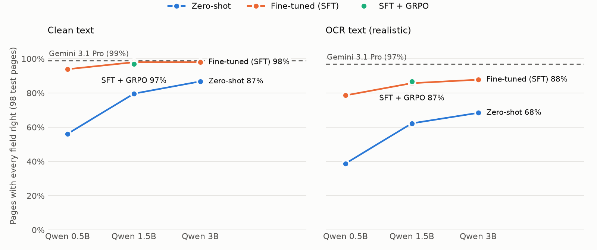

# F5: Can a small model read claim documents precisely?

**Task.** Given one page and its document type, return a JSON object with the facts it
contains. Four types: settlement letter (patient, policy number, claimed, approved, each
deduction amount), hospital bill (patient, admission and discharge dates, total), policy
schedule (policy number, insured patient, sum insured, co-pay %, room-rent limit) and
discharge summary (patient, admission and discharge dates). Schemas and scoring:
[bench/extract.py](../bench/extract.py).

F2 showed a fine-tuned 0.5B model can *recognise* a document. F5 asks whether it can *read*
one precisely: every amount, date and ID exactly right.

## Success bar (set 2026-10-24, before any results)

Set by Claude in auto mode, at Sudhakar's request, before any model was run on F5.

**Primary metric: page accuracy**, the share of test pages where *every* gold field is right.
One wrong amount spoils a claim, so partial credit doesn't count here.

1. **SFT:** the best fine-tuned Qwen (0.5B, 1.5B or 3B) is **within 2 points of Gemini 3.1 Pro
   on page accuracy, on OCR text**. If it is lower by more than 2 points but McNemar's test
   on whole pages finds no significant difference, it's reported as "statistically
   indistinguishable", not as a pass.
2. **GRPO:** GRPO trained on top of the SFT model **improves page accuracy on OCR text** over
   that SFT model. Reported with McNemar's test; a gain that isn't significant is reported
   as such.

Also reported for every model, but not deciding pass/fail: field accuracy, amount accuracy
(amounts and deduction lists only), valid-JSON rate, and per-field and per-type accuracy,
on clean and on OCR text.

## Data

Pages of the four types from the F2 dataset (F2's frozen case split) plus 400 new pages from
new cases (seeds 10,000+, assigned 70/15/15 by a fixed hash). Gold values come from each
page's claim case and only count if they appear in the page's clean text.

## Results

### In short

- **On clean text, fine-tuned small models read as precisely as Gemini.** Qwen 1.5B and 3B
  after SFT get 98.0% of pages fully right, against 99.0% for Gemini 3.1 Pro (statistically
  indistinguishable).
- **On OCR text, they fall short.** Best fine-tuned model 87.8% (3B) against Gemini's 96.9%:
  a real gap (McNemar p = 0.004). **Success bar 1 is not met.**
- **GRPO didn't help.** On top of the 1.5B SFT model: 86.7% vs 85.7% on OCR (one page, p = 1.0),
  96.9% vs 98.0% on clean. **Success bar 2 is not met.** During training, reward on the RL pages
  rose while validation accuracy fell: it learned those pages, not the skill.
- **No reward hacking:** no invented values for unchecked fields, answer length unchanged.

<picture>
  <source media="(prefers-color-scheme: dark)" srcset="f5_chart_dark.png">
  
</picture>

### Full results (98 test pages, 403 gold fields)

| Model | Method | Clean: pages | OCR: pages | OCR: fields | OCR: amounts |
|---|---|---|---|---|---|
| Qwen 0.5B | Zero-shot | 56.1% | 38.8% | 65.6% | 52.9% |
| Qwen 0.5B | Fine-tuned (SFT) | **93.9%** | **78.6%** | 92.6% | 87.9% |
| Qwen 1.5B | Zero-shot | 79.6% | 62.2% | 81.5% | 75.8% |
| Qwen 1.5B | Fine-tuned (SFT) | **98.0%** | **85.7%** | 95.8% | 96.2% |
| Qwen 1.5B | SFT + GRPO | 96.9% | 86.7% | 96.0% | 95.5% |
| Qwen 3B | Zero-shot | 86.7% | 68.4% | 89.7% | 83.4% |
| Qwen 3B | Fine-tuned (SFT) | **98.0%** | **87.8%** | 95.5% | 93.0% |
| Gemini 3.5 Flash | Zero-shot | 98.0% | 96.9% | 98.7% | 98.7% |
| Gemini 3.1 Pro | Zero-shot | 99.0% | 96.9% | 98.7% | 98.7% |

"Pages" = every gold field on the page right. All fine-tuned and Gemini outputs were valid JSON.

**Against Gemini 3.1 Pro (McNemar on whole pages; only Qwen right / only Gemini right):**

| | Clean | OCR |
|---|---|---|
| Qwen 1.5B SFT | 0 / 1, p = 1.00 | 0 / 11, **p = 0.001** |
| Qwen 3B SFT | 0 / 1, p = 1.00 | 0 / 9, **p = 0.004** |

### What goes wrong on OCR text

- **Some pages defeat every model, Gemini included:** the same admission date read one day
  off, the same room-rent limit misread (₹7,000 as ₹17,000 or ₹27,00,000). The OCR text itself
  is wrong there, which caps everyone below 100%.
- **Errors only the small models make:** copying the *wrong number from the page* (a date as
  the policy number, a second policy number on the page), dropping one item from a deduction
  list, and an extra digit (₹20 lakh as ₹2 crore). These are precision and attention errors,
  and they're why the small models trail Gemini by ~9–11 points.

### Why GRPO didn't help (and what might)

GRPO (method: [docs/RL_PRIMER.md](../docs/RL_PRIMER.md), code: [bench/grpo.py](../bench/grpo.py))
ran for 80 steps on the 1.5B SFT model: 8 pages × 8 sampled answers per step, reward = share of
fields right + 0.1 for valid JSON, on 200 pages kept apart from SFT, validation and test.

| Steps | Sample accuracy on RL pages | Validation page accuracy (OCR) | Groups with any signal |
|---|---|---|---|
| start | — | 85.4% | — |
| 1–20 | 80.7% | 84.3% | 3.0 / 8 |
| 21–40 | 86.8% | 84.3% | 2.5 / 8 |
| 41–60 | 88.0% | 84.3% | 1.9 / 8 |
| 61–80 | 89.8% | 80.9% | 1.6 / 8 |

1. **Too little signal.** GRPO learns only from pages where its sampled answers *disagree*. The
   SFT model was already consistent on most pages, so only ~2 of 8 pages per step taught it
   anything, and that fell as training went on.
2. **Too few RL pages.** 200 pages, each seen ~3 times: training reward rose while validation
   fell. The model was learning those pages rather than a general skill.
3. **Much of the remaining error isn't learnable from the text:** when OCR has destroyed the
   right digit, no policy can recover it.

What would plausibly help: many more RL pages (they're cheap to generate), a reward or
sampling setup that creates more disagreement (higher temperature, larger groups, hard-page
selection), keeping the best validation checkpoint instead of the last, and comparing all of
that against the simpler alternative of **SFT on more OCR examples**, which may well beat RL
here.

### Cost

About 400 + 200 extra synthetic pages (Gemini, roughly $5–8 of credits) and about 3 hours of
L4 Spot time for baselines, SFT at three sizes, GRPO and evaluation (≈ $1–1.50).

### Reproduce

```bash
uv run python -m bench.extract stats
uv run python -m bench.finetune --task extract --size 1.5B                   # on a GPU
uv run python -m bench.extract predict qwen --size 1.5B --variant ocr --adapter adapters/f5-qwen-1.5B
uv run python -m bench.grpo --size 1.5B --steps 80                            # on a GPU
uv run python -m bench.extract score preds/f5/qwen-1.5B-sft__ocr.jsonl --compare preds/f5/gemini-pro__ocr.jsonl
uv run python -m bench.report_f5
```

---

## F5b: closing the OCR gap (follow-up)

### Success bar (set 2026-10-25, before any F5b results)

Set by Claude in auto mode, at Sudhakar's request, before any F5b model was trained.
Same 98 test pages, OCR text, page accuracy; baseline = F5's Qwen 1.5B SFT (85.7%).

1. **SFT on augmented OCR data** (each training page also seen as 3 extra OCR readings of
   differently degraded images): **improves OCR page accuracy over 85.7%**, with McNemar's
   test reported, and is reported against Gemini 3.1 Pro (96.9%); "within 2 points of Gemini"
   would close the gap.
2. **GRPO v2** (1,000 RL prompts, hard-page mining, best validation checkpoint), started from
   the augmented SFT model: **improves OCR page accuracy over its starting point**, with
   McNemar's test reported.

Training data, RL data and test data stay disjoint: augmentation re-degrades training and
RL-only pages only; test pages keep their single original degraded image.

### F5b results

| Qwen 1.5B (98 test pages, page accuracy) | Clean | OCR |
|---|---|---|
| SFT (F5) | 98.0% | 85.7% |
| **SFT on augmented OCR data** | 94.9% | **90.8%** |
| Augmented SFT + GRPO v2 (best validation checkpoint) | 95.9% | 89.8% |
| Gemini 3.1 Pro | 99.0% | 96.9% |

McNemar on whole pages (only A right / only B right):

| A vs B | Clean | OCR |
|---|---|---|
| Augmented SFT vs F5 SFT | 1 / 4, p = 0.38 | **6 / 1**, p = 0.125 |
| Augmented SFT vs Gemini 3.1 Pro | 0 / 4, p = 0.13 | 0 / 6, **p = 0.031** |
| GRPO v2 vs augmented SFT | 1 / 0, p = 1.00 | 0 / 1, p = 1.00 |

**Against the F5b success bar:**

1. **Augmented SFT: improved, but not conclusively.** OCR page accuracy rose 85.7% → 90.8%
   (+5 points) and the gap to Gemini roughly halved (11 → 6 points). But 6 vs 1 pages is not
   significant at 5% (p = 0.125), and the remaining gap to Gemini *is* (p = 0.031). Not
   within 2 points of Gemini.
2. **GRPO v2: not met.** −1 page on OCR, +1 on clean; no difference.

**What the redesign changed, and what it didn't:**

- **OCR augmentation is the lever that works:** training on four different OCR readings of
  each page, instead of one, bought ~5 points on noisy text for ~$3 of Cloud Vision calls.
  It cost ~3 points on clean text (4 pages vs 1; not significant), plausibly because the
  training mix shifted to 4 OCR copies per clean one.
- **Mining fixed GRPO's signal problem but not its result.** It kept 444 of 1,000 RL prompts;
  early steps had ~5 of 8 informative groups (vs ~2 in F5). Validation peaked at 89.9% at step
  10 (+1 page) and drifted down to 86.5% by step 100 while training reward kept rising, the
  same over-fitting signature as F5. The best checkpoint was therefore almost the starting model.
- **Reward hacking:** none from GRPO. The augmented SFT model invented a room-rent limit on 1
  of 12 no-cap policies (GRPO didn't change that).

**Conclusion for this task:** for reading through OCR noise, **more varied supervised data beat
RL**. GRPO kept learning its training pages rather than the skill, even with ~1,000 prompts and
mining. The likely reasons: a strong SFT starting point leaves little consistent error to fix,
much remaining error is unrecoverable from the OCR text, and a page-level reward on 4–5 fields
is a blunt signal. The next lever is more and harder OCR data (more degradation types, more
pages), not more RL.

**Cost of F5b:** ~$3.30 of Cloud Vision (2,199 readings) and ~2 hours of L4 Spot (~$0.70).
